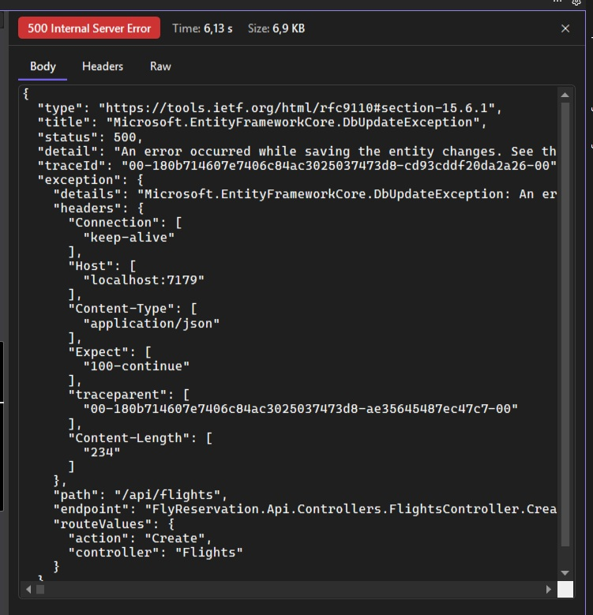
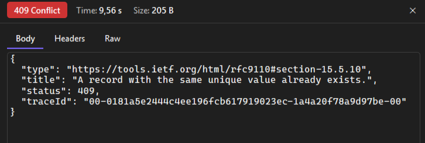
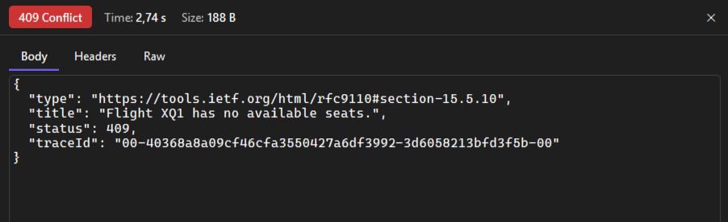
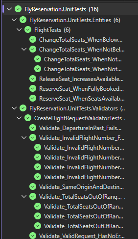
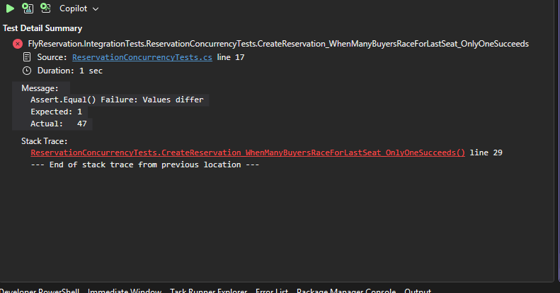
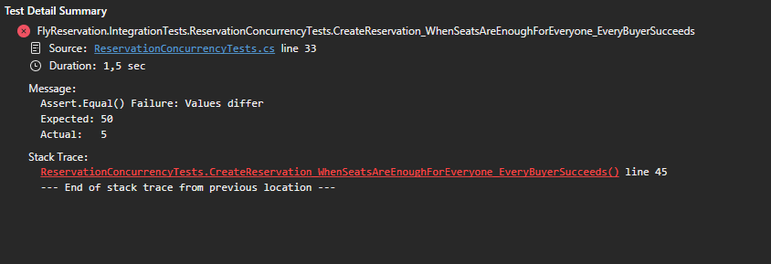

# Fly-Reservation

A flight booking REST API built with **.NET 10**, **ASP.NET Core**, **EF Core** and **PostgreSQL**.

The goal of this project is not CRUD. It is to run into the problems a real backend faces and solve them one at a time: **prove the problem with a test or an experiment first, then fix it, then measure the result.**

The most interesting finding: when 50 people try to book the **last seat** of a flight at the same moment, the first version of the API sold **up to 47 tickets for 1 seat**. See [The overbooking story](#the-overbooking-story).

---

## Tech stack

| Area | Tools |
|---|---|
| API | ASP.NET Core 10 (controllers), OpenAPI |
| Data | PostgreSQL 17, EF Core 10 (Npgsql), code-first migrations |
| Validation | FluentValidation (applied automatically with an action filter) |
| Errors | `IExceptionHandler` + ProblemDetails (RFC 9457) with `traceId` |
| Logging | Serilog (console, rolling file, Seq), structured message templates |
| Tests | xUnit, `WebApplicationFactory`, Testcontainers (real PostgreSQL in Docker) |
| Infra | Docker Compose (PostgreSQL + Seq) |

## Features

- **Flights, passengers, reservations:** full CRUD for flights and passengers; create, list and cancel reservations. Each reservation gets a unique 6-character PNR code.
- **Seat rules:** booking takes a seat, cancelling gives it back, and a flight's total seats cannot drop below the seats already sold.
- **Overbooking-safe under concurrency:** a single atomic SQL statement checks and takes the seat, so two requests can never take the same last seat.
- **Idempotent bookings:** a retry or double click with the same `Idempotency-Key` header gets the original reservation back instead of creating a second one. A passenger can hold only one seat per flight.
- **Two lines of defence:** request validation in the API (400) plus database rules: unique indexes, foreign keys with `RESTRICT` (no silent cascade deletes), and a check constraint `0 <= AvailableSeats <= TotalSeats`.
- **Consistent errors:** every error is a ProblemDetails response with a `traceId`. No stack traces or internal details reach the client.
- **Searchable logs:** the `traceId` in an error response finds every log line of that request in Seq. Expected 409s are logged as warnings, not errors.

## Architecture

```
HTTP request
  → Serilog request logging (one line per request: method, path, status, duration)
  → Global exception handler (exceptions → ProblemDetails)
  → Controller (thin: HTTP only)
      → FluentValidation filter (400 with field errors)
  → Service (business logic, throws NotFoundException / ConflictException)
      → Flight entity (seat rules, unit-testable without a database)
  → AppDbContext (EF Core) → PostgreSQL
```

```
src/FlyReservation.Api/
├── Controllers/        Flights, Passengers, Reservations
├── Services/           Business logic (Scoped, behind interfaces)
├── Entities/           Flight (seat rules), Passenger, Reservation
├── Dtos/               Request / response contracts (no entity is ever returned)
├── Validators/         FluentValidation rules
├── Filters/            Runs validators before every action
├── ExceptionHandling/  GlobalExceptionHandler
├── Data/               AppDbContext, indexes and constraints
└── Migrations/
tests/
├── FlyReservation.UnitTests/         Entity rules + validators (no database)
└── FlyReservation.IntegrationTests/  Real API + real PostgreSQL (Testcontainers)
```

### Error mapping

| Situation | Status |
|---|---|
| Invalid request body (e.g. -50 seats, same origin and destination) | `400` with field errors |
| Flight / passenger / reservation not found | `404` |
| Flight has no available seats | `409` |
| Passenger already has a reservation on this flight | `409` |
| `Idempotency-Key` reused for a different request | `422` |
| Total seats lowered below the seats already sold | `409` |
| Duplicate value (unique index, PostgreSQL `23505`) | `409` |
| Record still referenced, e.g. deleting a flight that has reservations (`23503`) | `409` |
| Anything else | `500` with a generic message + `traceId` (full exception only in the logs) |

Every error has the same shape: a ProblemDetails body with a `traceId` that finds the request's logs in Seq.

<!-- Before: the stack trace leak. Uncomment after checking that no C:\Users\... path is visible

-->

| Duplicate flight → `409` | Fully booked flight → `409` |
|---|---|
|  |  |

## API

| Method | Endpoint | Description |
|---|---|---|
| `GET` | `/api/flights` | List flights |
| `GET` | `/api/flights/{id}` | Get a flight |
| `POST` | `/api/flights` | Create a flight |
| `PUT` | `/api/flights/{id}` | Update a flight (seat count is recalculated) |
| `DELETE` | `/api/flights/{id}` | Delete a flight (409 if it has reservations) |
| `GET` | `/api/passengers` | List passengers |
| `GET` | `/api/passengers/{id}` | Get a passenger |
| `POST` | `/api/passengers` | Create a passenger (email is unique) |
| `PUT` | `/api/passengers/{id}` | Update a passenger |
| `DELETE` | `/api/passengers/{id}` | Delete a passenger (409 if they have reservations) |
| `GET` | `/api/reservations` | List reservations |
| `GET` | `/api/reservations/{id}` | Get a reservation |
| `POST` | `/api/reservations` | Book a seat (`{ "flightId": 1, "passengerId": 1 }`). Optional `Idempotency-Key` header makes retries safe |
| `DELETE` | `/api/reservations/{id}` | Cancel a reservation and release the seat |

Ready-to-send requests are in the `.http` files under `src/FlyReservation.Api/` (Visual Studio / VS Code / Rider).

## Getting started

**Requirements:** .NET 10 SDK, Docker.

```bash
# 1. Start PostgreSQL (port 5434) and Seq (port 5343)
docker compose up -d

# 2. Store the connection string as a user secret (development credentials from docker-compose.yml)
dotnet user-secrets set "ConnectionStrings:FlyReservationDb" \
  "Host=localhost;Port=5434;Database=flyreservation;Username=flyuser;Password=flypass" \
  --project src/FlyReservation.Api

# 3. Create the database schema
dotnet tool install --global dotnet-ef   # once
dotnet ef database update --project src/FlyReservation.Api

# 4. Run the API → http://localhost:5177
dotnet run --project src/FlyReservation.Api
```

- OpenAPI document (Development): `http://localhost:5177/openapi/v1.json`
- Seq log UI: `http://localhost:5343`

## Tests

```bash
dotnet test   # Docker must be running: integration tests start their own PostgreSQL container
```

| Project | Count | What it covers |
|---|---|---|
| `FlyReservation.UnitTests` | 16 tests, ~70 ms | Seat rules on the `Flight` entity, flight request validation |
| `FlyReservation.IntegrationTests` | 14 tests | The real API in memory (`WebApplicationFactory`) against a throwaway PostgreSQL 17 container (Testcontainers): 400/404/409/422 responses, seat counts, concurrent bookings, idempotent retries |



Integration tests never touch the development database. Each test run gets a clean database and applies the real migrations, so constraints and transactions behave exactly as in production. The EF Core InMemory provider was deliberately not used: it has no constraints or transactions.

Why both kinds? As an experiment, the `ReserveSeat()` call was removed from the booking service: **all 16 unit tests stayed green, while 4 integration tests turned red.** Unit tests check each part on its own; integration tests check that the parts are wired together.

<!-- 📸 docs/images/14-sabotage-unit-green-integration-red.png -->

## The overbooking story

### The problem

Every test was green, but every test sent its requests **one at a time**. An integration test that sends **50 booking requests at the same moment** (`Task.WhenAll`) for a flight with **1 seat** showed what really happens:

| Run | Tickets sold for 1 seat |
|---|---|
| 1 | 21 |
| 2 | 33 |
| 3 | 47 |

After each run the flight showed `AvailableSeats = 0`, so from the outside nothing looked wrong.



### Root cause: lost update

The booking code did **read → decrement in C# → write**. All requests read `AvailableSeats = 1` before the first one committed, and all of them wrote `0`.

- **The transaction did not help:** PostgreSQL's default isolation level is Read Committed, which does not stop two transactions from reading the same value.
- **The check constraint did not help:** nobody wrote a negative number; everyone wrote `0`.
- **A C# `lock` would not help either:** with more than one server, each server has its own lock. The guarantee has to come from the database that all servers share.

### Four fixes, measured with the same tests

Each strategy was run against two concurrency tests:

- **Last seat:** 50 buyers, 1 seat → exactly 1 must succeed (no overbooking).
- **Enough seats:** 50 buyers, 50 seats → all 50 must succeed (no needless rejections).

| Strategy | Last seat (1 seat) | Enough seats (50 seats) | Notes |
|---|---|---|---|
| **Atomic conditional UPDATE** ✅ *chosen* | ✅ 1 | ✅ 50 / 50 | One SQL statement, no extra locking code |
| Pessimistic lock (`SELECT ... FOR UPDATE`) | ✅ 1 | ✅ 50 / 50 | Correct, ~30–40% slower on the last-seat test. Without a transaction the lock is released at once → 32–40 tickets |
| Optimistic concurrency (`xmin` + 3 retries) | ✅ 1 | ❌ 4–6 / 50 | With 10 retries: 13–15 / 50, ~800 ms |
| Serializable isolation (5 retries) | ✅ 1 | ❌ 5 / 50 | The other 45 requests got `500` |

Before measuring, the expected winner was optimistic concurrency. **The measurement proved that wrong:** every booking updates the **same row** (a hot spot), so each retry round has only one winner and most valid bookings are rejected even though seats are free. Optimistic and serializable never overbooked; their problem is availability (a high abort rate), not correctness.



### The fix

The seat check and the decrement happen in **one statement**. PostgreSQL locks the row for the update, so concurrent requests are queued instead of reading a stale value:

```sql
UPDATE "Flights"
SET "AvailableSeats" = "AvailableSeats" - 1
WHERE "Id" = @flightId AND "AvailableSeats" > 0;
-- 0 rows affected → 409 Conflict ("no available seats")
```

In EF Core this is `ExecuteUpdateAsync`, inside the same transaction as the reservation `INSERT`, so a seat is never taken without a reservation being saved:

```csharp
await using var transaction = await _context.Database.BeginTransactionAsync();

var reservedSeats = await _context.Flights
    .Where(f => f.Id == request.FlightId && f.AvailableSeats > 0)
    .ExecuteUpdateAsync(setters => setters.SetProperty(f => f.AvailableSeats, f => f.AvailableSeats - 1));

if (reservedSeats == 0)
    throw new ConflictException($"Flight {flight.FlightNumber} has no available seats.");

_context.Reservations.Add(reservation);
await _context.SaveChangesAsync();
await transaction.CommitAsync();
```

**Result:** the last-seat test sells **exactly 1 ticket on every run (was up to 47)**, and 50 buyers for 50 seats all succeed. Both tests stay in the suite as regression tests.

**Trade-off:** in the booking path the seat rule moved from the `Flight` entity into SQL.

> Later, for [idempotent bookings](#idempotent-bookings), the reservation insert moved **before** the seat update. Both still run in one transaction, so a failed seat update rolls the insert back.

<!-- 📸 docs/images/16-after-concurrency-tests-green.png -->

### Experiment branches

The alternative strategies are kept as branches so they can be run and compared:

- [`experiment/optimistic-concurrency`](https://github.com/utkucakarr/Fly-Reservation/tree/experiment/optimistic-concurrency): `xmin` concurrency token, retry loop, `DbUpdateConcurrencyException` → 409
- [`experiment/pessimistic-lock`](https://github.com/utkucakarr/Fly-Reservation/tree/experiment/pessimistic-lock): `SELECT ... FOR UPDATE` inside a transaction

## Idempotent bookings

### The problem

Sending the same booking request twice, like a double click, created **two reservations** for the same passenger on the same flight and took two seats. Disabling the button on the client helps, but it is not a guarantee: slow networks and HTTP clients that retry on timeout can also deliver the same request twice.

There are two different problems here, solved with two different tools.

### 1. Composite unique constraint: protecting the data

Business rule: **one passenger, one seat per flight.** It is enforced in the database:

```csharp
entity.HasIndex(r => new { r.FlightId, r.PassengerId }).IsUnique();
```

The service also checks "does this passenger already have a seat?" first, but only to return a readable `409`. Two concurrent requests can both pass that check (a check-then-act race); the unique index is the real guarantee.

### 2. Idempotency-Key: giving the client the right response

With only the constraint, the second click gets a `409`, although the first one succeeded. The client sees an error and doesn't know its booking code.

So the client generates a random key once per booking intent and sends it with every attempt:

```http
POST /api/reservations
Idempotency-Key: 6f1c2a9e-4b7d-4d2e-9a51-3e8f0c7b2d14
```

| Situation | Response |
|---|---|
| Key seen for the first time | Book as usual, store the key with the reservation → `201` |
| Same key again | No new booking, the original reservation comes back → `201`, same PNR |
| Same key, concurrent requests | The reservation is inserted **before** the seat update, so the others wait on the unique index on the key, then get the same `201` |
| Same key, different flight or passenger | `422 Unprocessable Entity` |

### Why both?

| | Unique constraint | Idempotency-Key |
|---|---|---|
| Protects | The **data**: "this reservation already exists" | The **request**: "I have already processed this" |
| A repeated request gets | `409` | The original `201` |
| Depends on the client? | No | Yes: a client that sends no key, or a new key per click, is not covered |

The key gives a well-behaved client the right response; the constraint keeps the data correct no matter what the client does.

<!-- 📸 docs/images/17-after-same-key-same-pnr.png -->

## Other problems solved along the way

| Problem | How it showed up | Fix |
|---|---|---|
| Stack trace leaking to clients | `500` responses contained stack traces, table names and server file paths | Global `IExceptionHandler`: ProblemDetails + `traceId` only |
| Circular JSON + data leak | Returning entities caused a reference loop; "ignore cycles" exposed passport numbers | Request/response DTOs (also blocks over-posting such as `"availableSeats": 5000`) |
| Silent cascade delete | Deleting a flight would have deleted all its reservations | `DeleteBehavior.Restrict` + FK violation → 409 |
| Seats never decremented | A 2-seat flight could be sold 3 times | Seat rules on the entity + check constraint + data migration. The migration failed on existing data, which exposed a real hidden overbooking |
| False error alarms | One expected 409 produced 2 `Error` logs from EF Core | EF Core command errors lowered to Debug; the handler decides severity → **2 → 0** false errors |
| Logs lying about status codes | Client got `409`, the request log said `500` | Request logging moved outside the exception handler middleware |
| Untestable business rule | The seat rule lived in a service that needs a real database | Moved into the `Flight` entity → 16 unit tests, ~70 ms |

## Known limitations

These are known and deliberately left for later steps:

- Concurrent cancellations can lose seat releases: `ReleaseSeat` still uses read → modify → write.
- Cancelling the same reservation twice at the same moment can return `500` instead of `404`.
- Updating a flight's total seats while bookings are in progress is not concurrency-safe.
- Idempotency keys are stored forever and are not tied to a user yet (needs authentication).
- No authentication yet.

## Roadmap

- [x] REST API, PostgreSQL, EF Core migrations, relationships
- [x] DTOs, validation, global error handling, service layer
- [x] Structured logging (Serilog + Seq)
- [x] Unit and integration tests (Testcontainers)
- [x] Concurrency-safe seat booking
- [x] Idempotent booking requests
- [ ] Query performance (indexes, `EXPLAIN ANALYZE`) and caching
- [ ] Reservation expiry with a background service, outbox pattern
- [ ] Authentication / authorization, rate limiting
- [ ] Observability (tracing), CI with GitHub Actions
